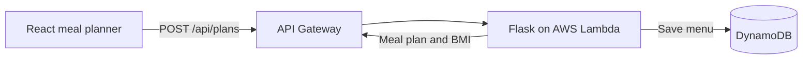

# LaiD · Personalized Meal Planner

LaiD is a rebuild of a project I made as an undergraduate. It turns a dietary preference into a few days of meal ideas and calculates adult BMI alongside the plan.

## The original LaiD project

Sheershak and I built the first version of LaiD as an undergraduate project around 2022. We wanted to see whether a program could take someone’s dietary preferences and body measurements and turn them into a weekly meal plan. Our paper describes the approach and shows an example week of breakfasts, lunches, and dinners.

The paper is what I still have from that project. The React and Flask code in this repository is a later rebuild that lets you try the meal planner and generate a grocery checklist.

[Read the original AI Dietician paper](https://drive.google.com/file/d/1QJSTYpC9eSPogkVF5r31D7mwvgweBlov/view)

## How it works



The API validates the input, selects meals from a curated catalog, and calculates BMI from height and weight. The menu follows the selected diet. BMI is displayed separately and does not set calorie targets or portions. The AWS deployment stores only the generated menu and dietary preference under a random ID. Height, weight, and BMI are kept out of DynamoDB.

## Run locally

In the first terminal, from the repository root:

```sh
python3 -m venv .venv
source .venv/bin/activate
python -m pip install -r requirements.txt
python -m flask --app app run
```

In a second terminal:

```sh
npm ci
npm run dev
```

Open the URL shown by Vite, normally http://localhost:5173. Vite forwards API calls to Flask on port 5000. The local planner works without AWS credentials or a database.

Try the API directly:

```sh
curl -s http://127.0.0.1:5000/api/plans \
  -H 'Content-Type: application/json' \
  -d '{"height_cm":175,"weight_kg":70,"diet":"vegetarian","days":3}'
```

## Deploy the API

The AWS SAM template defines an HTTP API, a Python Lambda function, and a DynamoDB table. With AWS credentials and the SAM CLI configured, run `sam build` and `sam deploy --guided`. Set `FrontendOrigin` to the origin where you host the frontend.

For a hosted frontend, set `VITE_API_URL` to the stack's `ApiUrl` output before running `npm run build` from the repository root. Deploy the resulting `dist` directory to a static host. For a public launch, add request throttling and a data retention policy.

BMI is an adult screening measure. [CDC adult BMI guidance](https://www.cdc.gov/bmi/adult-calculator/)
